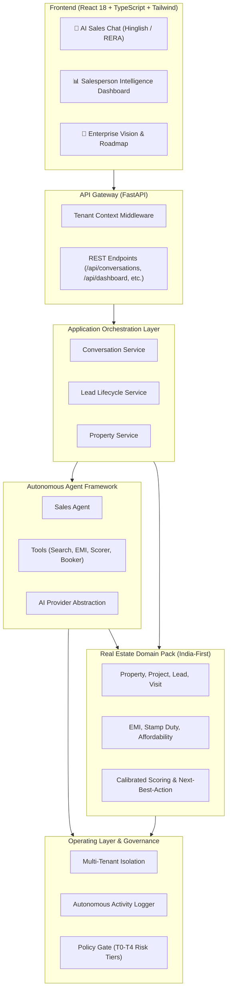

# EstateIQ — Autonomous Real Estate Intelligence Platform (V0 Demo)

> **Architectural Principle:** Small Product Surface + Future-Proof Core.  
> Turn raw customer inquiries into qualified, prioritized, and actionable business outcomes.

---

## 🏗️ Architecture Overview

EstateIQ is architected around **Hexagonal Domain-Driven Design (DDD)** to ensure the core business intelligence remains strictly decoupled from AI models, UI frameworks, and third-party SaaS tools.



---

## ⚡ The Hero Demo Scenario

Experience the complete buyer journey in under 2 minutes:

1. **Buyer Inquiry (WhatsApp / Chat):**  
   `"Baner mein 3BHK chahiye, budget 90 lakh tak hai, loan lagega."`
2. **EstateIQ Agent Understanding:**  
   - Location: **Baner Corridor**
   - Unit Type: **3 BHK**
   - Budget: **₹90 Lakhs**
   - Financing: **Home Loan Required**
3. **Inventory Grounding (Zero Hallucination):**  
   - Matches verified inventory (e.g. *VTP Blue Waters 3BHK Elite* @ ₹88L).
   - Computes deterministic EMI estimate: **₹61,095 / month** (8.5% p.a., 20 years on 80% loan).
   - Generates RERA verification citations.
4. **Autonomous Site Visit Booking:**  
   - Customer says: `"Saturday visit book karo"`
   - Agent confirms booking for Saturday 11:30 AM with gate pass instructions and assigns sales consultant **Rahul Sharma**.
5. **Real-Time Salesperson Intelligence:**  
   - Updates CRM with **HOT LEAD (Score: 81/100, Calibrated Conversion Probability: 83%)**.
   - Prescribes Next-Best-Action: `"Call within 10 minutes and confirm site visit."`
   - Records full execution in the immutable **Activity Audit Log**.

---

## 🚀 Quickstart: Running EstateIQ V0

### 1. Prerequisites
- **Python 3.11+**
- **Bun** or **Node.js**

### 2. Backend Setup
```bash
cd backend
# Create virtual environment & install dependencies
python -m venv .venv
.\.venv\Scripts\activate   # (On Windows) or source .venv/bin/activate
pip install -r requirements.txt

# Run the verification test suite
python tests/test_hero_journey.py

# Start FastAPI server (runs at http://localhost:8000)
python main.py
```

### 3. Frontend Setup
```bash
cd frontend
# Install dependencies & run Vite dev server
bun install    # or npm install
bun run dev    # or npm run dev
```
Open your browser at **http://localhost:5173**.

---

## 🛡️ Key Architectural Boundaries

| Layer | V0 Implementation | Future SaaS Evolution |
|---|---|---|
| **Multi-Tenancy** | Scoped `TenantContext` & Middleware | PostgreSQL Row-Level Security (RLS) + Schema Isolation |
| **AI Provider** | Regex & Pattern-based Hinglish NLU | Model routing (Gemini 2.5 Flash, Claude 3.5, local SLMs) |
| **Agent Framework** | Single Sales Agent with Tool Registry | LangGraph Supervisor-Specialist Network |
| **Domain Layer** | Pune Real Estate Pack (BHK, Lakhs, RERA) | Swappable Multi-Vertical Domain Packs |
| **Governance** | Mock Policy Gate (T0-T4 classification) | Cryptographic Audit Log & Maker-Checker Approvals |

---

## 📌 Simulated Data Notice
All property records, buyer personas, RERA certificates, and ML lead scores in V0 are simulated for demonstration purposes.
